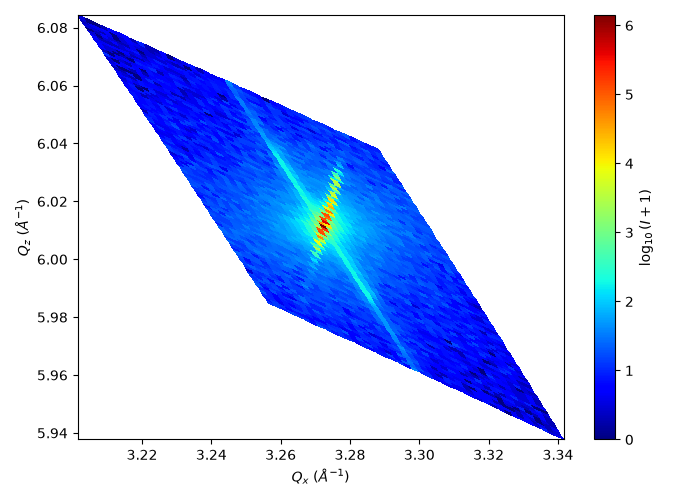

# XRDML RSM Plotter

I wrote this Python script to check my X-ray diffraction measurements on thin films. It reads PANalytical XRDML files and displays either a reciprocal space map (Qx–Qz) or a 1D 2θ–ω scan, depending on the data. It also prints the position of the strongest peak.

## How to run

1. Install NumPy and Matplotlib with `python -m pip install numpy matplotlib`.
2. Put your `.xrdml` file in the same folder as `plot_xrdml.py` and set `FILENAME` at the top of the script to your file name.
3. Run `python plot_xrdml.py`.
